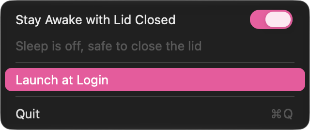

# SlopCaffeinate

A menu bar switch that keeps a MacBook awake with the lid closed. I built it so coding agents can keep working while the laptop sits in my backpack.



The menu bar icon is a coffee cup while sleep is off and a moon in normal mode.

## What the switch does

Turning it on runs:

```sh
sudo pmset -b sleep 0
sudo pmset -b disablesleep 1
```

Turning it off runs:

```sh
sudo pmset -b sleep 5
sudo pmset -b disablesleep 0
```

`disablesleep 1` turns off system sleep completely. Closing the lid won't put the Mac to sleep, and neither will the idle timer, on battery or on the charger. The display still turns off on its usual schedule.

The app reads `SleepDisabled` from `pmset -g` when you open the menu and every 10 seconds after that. If you change the setting from a terminal, the icon catches up.

## Read this before you zip up the bag

- While the switch is on, the Mac never sleeps. That includes sitting on your desk with the lid open. Turn it off when the agents are done.
- A closed laptop running a heavy job in a bag gets hot.
- I haven't tested what happens at critically low battery with `disablesleep` set. Plan for the battery running all the way down.
- Turning the switch off sets battery sleep to 5 minutes, whatever it was before. If you use a different value, change it in `Sources/main.swift`.
- Quitting the app leaves the setting as it is. Turn the switch off first if you want normal sleep back.

## Install

### Download the app

1. Download `SlopCaffeinate.zip` from the [latest release](https://github.com/Luaneo/slop-caffeinate/releases/latest) and unzip it.
2. Drag `SlopCaffeinate.app` into `/Applications`.
3. Open it. macOS will block it the first time. The app isn't notarized, because notarization needs a paid Apple developer account.
4. Open System Settings > Privacy & Security, scroll down to the message about SlopCaffeinate and click "Open Anyway".

If you'd rather skip steps 3 and 4, run this once:

```sh
xattr -dr com.apple.quarantine /Applications/SlopCaffeinate.app
```

### Build from source

You need the Xcode Command Line Tools for `swiftc`. Run `xcode-select --install` if you don't have them.

```sh
git clone https://github.com/Luaneo/slop-caffeinate.git
cd slop-caffeinate
./build.sh --install
```

This builds the app, signs it ad hoc, copies it to `/Applications` and launches it. macOS doesn't quarantine apps you build yourself, so there's no Gatekeeper prompt. Plain `./build.sh` only builds into `build/`.

### After installing

Start it from Launchpad or Spotlight like any other app. "Launch at Login" is in the menu. macOS may ask you to approve it in System Settings > General > Login Items.

The app is a universal binary for Apple silicon and Intel and targets macOS 14 and later. I've only run it on macOS 27 on Apple silicon.

## The password prompt

`pmset` needs root. The first time you flip the switch, the app offers two options.

**Allow Without Password.** You enter your admin password once, and the app writes `/etc/sudoers.d/slop-caffeinate` with this rule:

```
yourname ALL=(root) NOPASSWD: /usr/bin/pmset -b sleep 0, /usr/bin/pmset -b disablesleep 1, /usr/bin/pmset -b sleep 5, /usr/bin/pmset -b disablesleep 0
```

sudo matches the full command line, so only these four commands run without a password. Any other `pmset` call still asks. The app checks the file with `visudo -c` before installing it.

**Just This Once.** macOS asks for your password on every flip.

## Uninstall

Turn the switch off and untick "Launch at Login" first. Then:

```sh
rm -rf /Applications/SlopCaffeinate.app
sudo rm -f /etc/sudoers.d/slop-caffeinate
```

## How it's built

It's one Swift file using AppKit. There's no Xcode project and no dependencies. `build.sh` compiles it with `swiftc` and assembles the `.app` bundle by hand.

The app becomes the active app while its menu is open. It has to, because macOS draws controls in an inactive app in gray, and the switch would never show your accent color. When the menu closes, focus goes back to the app you were using.

The UI is in English and Russian.

## License

MIT
